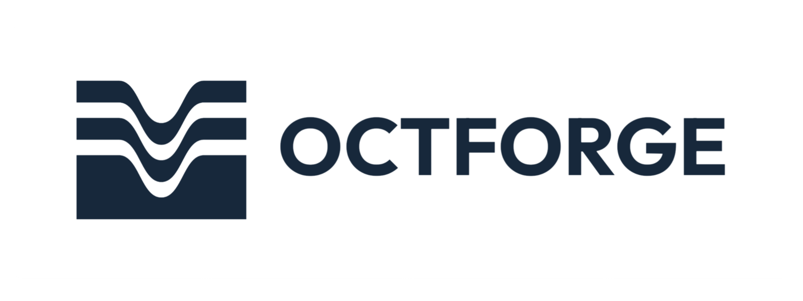
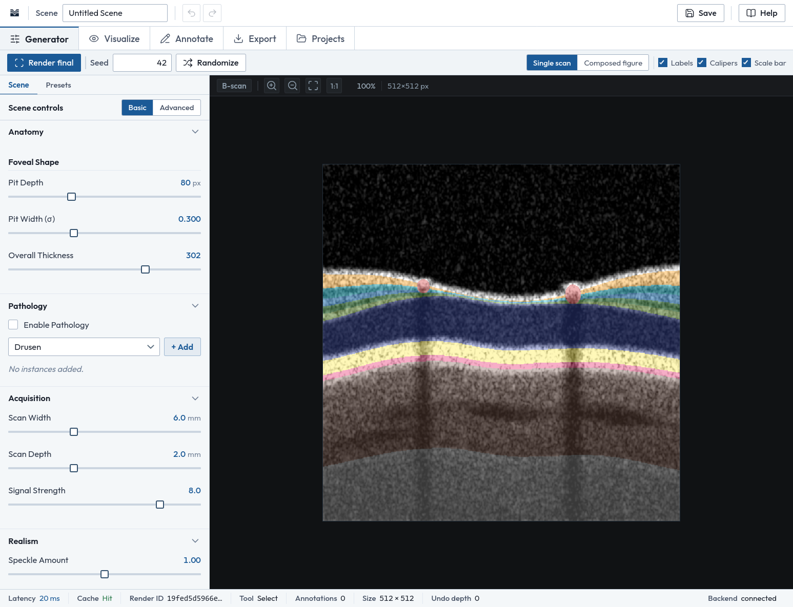
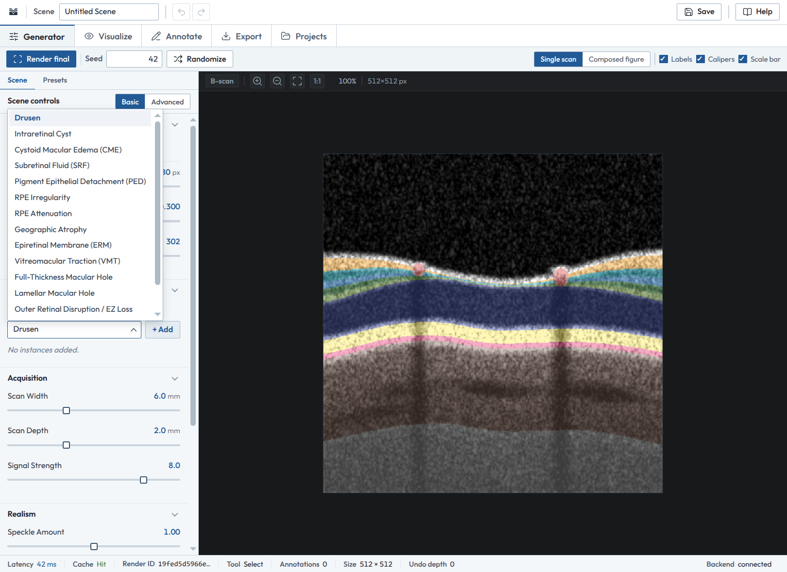
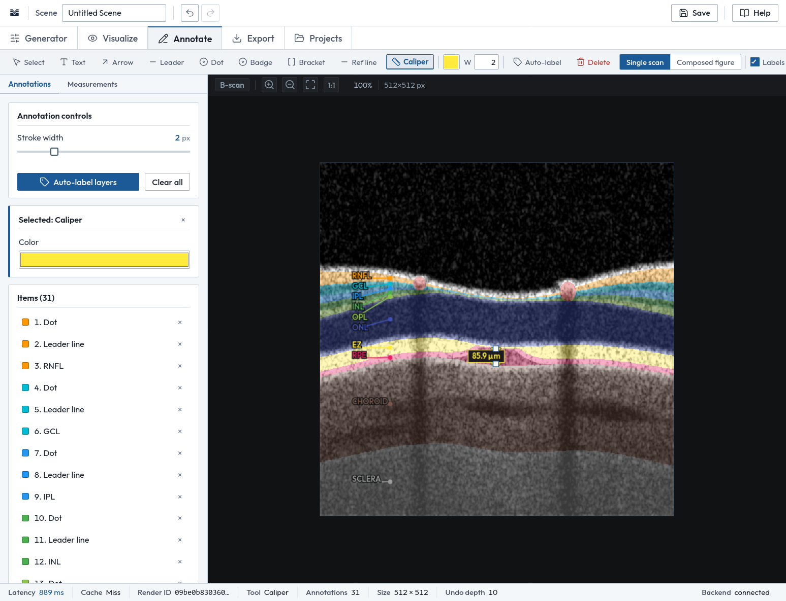
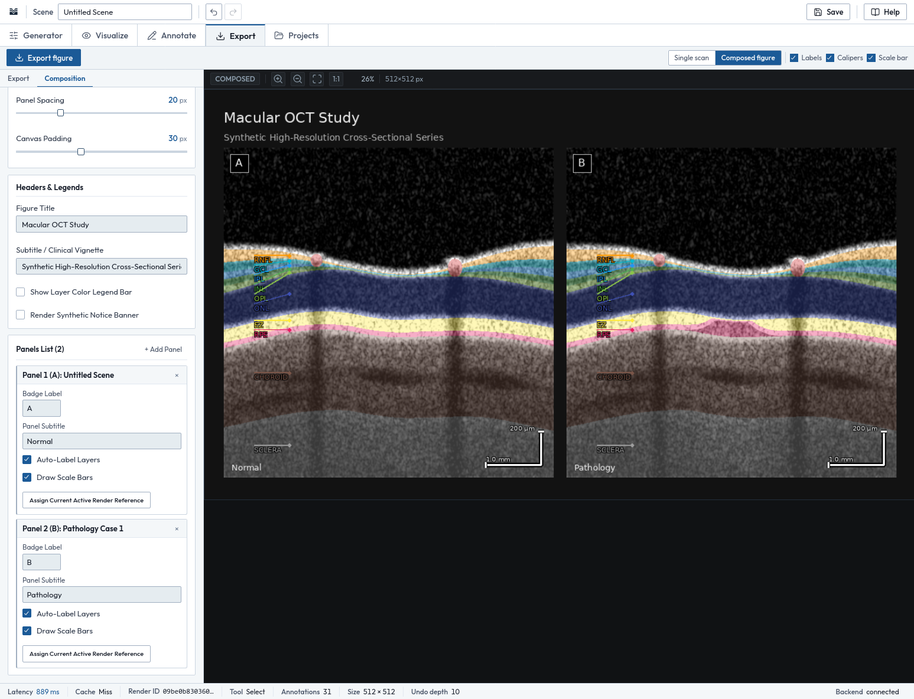

<p align="center">
  
</p>

<p align="center">
  <strong>Synthetic retinal OCT figure authoring.</strong><br>
  Generate synthetic OCT B-scans from a parametric retinal model, then annotate, measure, compose and export them as figures for teaching and scientific-style illustration. OCTForge runs on your own computer.
</p>

<p align="center">
  <a href="#installation"></a>
  <a href="#technology-stack"></a>
  <a href="#technology-stack"></a>
  <a href="#privacy-security-and-limitations"></a>
  <a href="#installation"></a>
  <a href="#privacy-security-and-limitations"></a>
</p>

<p align="center">
  <a href="#installation">Installation</a> ·
  <a href="#usage-guide">Usage guide</a> ·
  <a href="#technical-foundations">Technical foundations</a> ·
  <a href="#privacy-security-and-limitations">Privacy and limitations</a>
</p>

---

## Table of contents

- [Overview](#overview)
- [Visual tour](#visual-tour)
- [Features](#features)
- [Typical workflow](#typical-workflow)
- [Technical foundations](#technical-foundations)
- [Installation](#installation)
- [Quick start](#quick-start)
- [Usage guide](#usage-guide)
- [Export and file handling](#export-and-file-handling)
- [Troubleshooting](#troubleshooting)
- [Project architecture](#project-architecture)
- [Technology stack](#technology-stack)
- [Configuration](#configuration)
- [Privacy, security, and limitations](#privacy-security-and-limitations)
- [Testing](#testing)
- [Contributing](#contributing)
- [Acknowledgments and references](#acknowledgments-and-references)
- [License](#license)
- [Author and contact](#author-and-contact)

---

## Overview

Real OCT scans make awkward teaching cases. They carry patient identifiers, consent constraints and uneven image quality. OCTForge takes a different route: an educator describes a retina, adds a pathology, chooses an acquisition setup, and produces a clean synthetic cross-section that fits the question being taught.

Scenes can then be annotated, measured, composed into multi-panel figures, saved as projects, and exported for slides, print and the web.

| | |
|---|---|
| **Synthetic** | Images are generated from parameters. No real scans are imported or displayed. |
| **Local** | The renderer and your scene data stay on your machine. |
| **Reproducible** | A fixed seed reproduces the same image. |

**Intended for** medical education, teaching cases, lecture slides, course materials and scientific-style figures. **Not intended for** diagnosis, triage, treatment planning or any decision about a real patient. See [Privacy, security, and limitations](#privacy-security-and-limitations).

Current version: **1.0.0**.

<p align="center">
  <br>
  <sub><em>The Generator workspace: scene controls on the left, the rendered synthetic B-scan on the right. All imagery is synthetic.</em></sub>
</p>

---

## Visual tour

All images below are screenshots of the OCTForge interface. Every scan shown in them is **synthetic**.

### Describe the scene

<p align="center">
  <br>
  <sub><em>The pathology dropdown in the Generator workspace. Pathology instances are added to a scene and tuned individually.</em></sub>
</p>

### Annotate and measure

<p align="center">
  <br>
  <sub><em>The Annotate workspace after <strong>Auto-label layers</strong>, with a caliper measurement of 85.9 µm. Annotations are separate from the rendered image.</em></sub>
</p>

### Compose a figure

<p align="center">
  <br>
  <sub><em>The Composition tab: a two-panel figure with title, A/B badges, panel captions and scale bars.</em></sub>
</p>

---

## Features

### Scene generation

- **Parametric anatomy.** Set foveal pit depth and width and overall retinal thickness.
- **Pathology instances.** Add pathology to a scene and tune severity, size, extent, location and reflectivity.
- **Twelve presets.** Start from a preset, then change anything. Presets are parametric starting points for illustration (listed below).
- **Acquisition settings.** Scan width, scan depth and signal strength.
- **Realism controls.** Speckle, contrast and gamma.
- **Seven optional artifacts.** Motion, dropout, shadowing, saturation, mirror, poor signal and banding.
- **Seed and Randomize.** A fixed seed reproduces an image; Randomize draws a new scene within physiological bounds.
- **Basic / Advanced** parameter views, with automatic preview re-rendering as values change and a **Render final** action that produces the full-quality image together with its layer map.

**Presets**

| | | |
|---|---|---|
| Normal Macula | CME | SRF |
| Drusen | PED | ERM |
| Full-Thickness Macular Hole | Lamellar Macular Hole | Geographic Atrophy |
| VMT | Outer Retinal Disruption | Hyperreflective Foci |

### Visualization

- Four display modes: grayscale, colored layers, hybrid and educational.
- Palettes: clinical, color-blind-safe, educational and custom, with global opacity and per-layer color, opacity and visibility.
- Changing display settings does **not** re-render the scan.

### Annotation and measurement

- **Auto-label** places a dot, leader line and label on each of ten layers, using the renderer's own layer map: RNFL, GCL, IPL, INL, OPL, ONL, EZ, RPE, choroid and sclera.
- **Calipers** report distance in micrometers or millimeters, calibrated from the scan's width and depth.
- **Measurements** lists central foveal thickness, mean total retinal thickness, foveal pit depth and width, and the thickness of each layer.
- Manual tools: text boxes, arrows, leader lines, dots, numbered badges, brackets and reference lines, with a property inspector for text, font size, rotation and color.
- Annotations are stored as vector data and never alter the rendered image.

### Figure composition and export

- Layouts: single, side-by-side, strips, stacks, 2 × 2 or an automatic grid.
- Figure title, panel captions, A–D badges, an optional layer legend and scale bars (1 mm lateral, 200 µm axial) drawn from the scan's own dimensions.
- Export to PNG, JPEG, TIFF, PDF or SVG (with a vector overlay) at 72 to 1200 DPI, from seven presets or custom settings. See [Export and file handling](#export-and-file-handling).

### Projects and interface

- Save, load, duplicate, rename, reset and delete scenes as JSON project files.
- Undo and redo for up to 64 scene changes.
- Single-key tool shortcuts in the Annotate workspace, zoom and pan, and keyboard navigation between workspace tabs. See [Keyboard shortcuts](#keyboard-shortcuts).

---

## Typical workflow

1. **Describe.** Open the **Generator** workspace. Start from a preset on the **Presets** tab, or set anatomy, pathology, acquisition, realism and artifacts on the **Scene** tab. The preview updates as you change values.
2. **Render.** Choose **Render final** to produce the full-quality B-scan with its matching layer map. Keep the **Seed** fixed if you need to reproduce the image later.
3. **Visualize.** In the **Visualize** workspace, choose a display mode, palette and per-layer opacity. The scan is not re-rendered.
4. **Annotate and measure.** In the **Annotate** workspace, use **Auto-label layers**, then add arrows, text, badges or calipers as needed. The **Measurements** tab lists thickness values and can draw scale bars.
5. **Compose.** In the **Export** workspace, open the **Composition** tab. Set a figure title, add panels, assign a scene to each panel, and set badges and captions. Use the **Single scan / Composed figure** switch to change what the viewer shows.
6. **Export.** Choose a preset or detailed settings and select **Export figure**. The file is downloaded by your browser.
7. **Save.** Use **Save** in the application bar to keep the scene as a project. Scenes live in browser memory until saved.

---

## Technical foundations

OCTForge is a **procedural, physically motivated approximation** of retinal OCT. It is not a clinical-grade physical simulation, and its output should be read as illustration, not as a measurement of a real eye.

A scene passes through a forward model with these stages:

| Stage | What it does |
|---|---|
| **Parametric anatomy** | Foveal shape, boundary irregularity, per-layer thickness and reflectivity. |
| **Pathology deformation** | Lesions such as cysts, fluid or drusen deform and re-reflect the anatomy. |
| **Optical forward model** | Beer–Lambert attenuation and coherent, PSF-correlated speckle. |
| **Acquisition and artifacts** | Scan geometry, resolution, averaging and optional artifacts. |
| **Display mapping** | Dynamic range, gamma and window level. |

The renderer produces a grayscale B-scan and a matching layer map. Layer labels, measurements and the colored display modes are derived from that map, which is why they stay consistent with the image.

> **Scientific caveat.** The forward model borrows established concepts from OCT physics and retinal anatomy, but this repository does not claim that its output reproduces clinical pathology faithfully, and no clinical or experimental validation is claimed. Presets and pathology models are illustrative starting points.

For background reading on the established concepts, see [Acknowledgments and references](#acknowledgments-and-references).

---

## Installation

OCTForge is distributed as **source code**. There is no installer or prebuilt binary.

**Requirements**

- Python 3.12 or newer
- Git
- A current desktop browser

Run every command from the repository root.

**1. Clone the repository**

```bash
git clone https://github.com/YOUR-ORG/octforge.git
cd octforge
```

**2. Create and activate a virtual environment**

macOS / Linux:

```bash
python3 -m venv .venv
source .venv/bin/activate
```

Windows:

```bash
python -m venv .venv
.venv\Scripts\activate
```

**3. Install the dependencies**

```bash
pip install -r backend/requirements.txt
```

### Developer installation

Running the test suite requires `httpx` in addition to the application dependencies:

```bash
pip install httpx
```

---

## Quick start

From the repository root, with the virtual environment active:

```bash
python run.py
```

The launcher starts one Uvicorn server on `127.0.0.1:8000` and polls `/api/health`. When the server answers, your default browser opens `http://127.0.0.1:8000/` and shows the **Start page** with an **Open workspace** button.

If the health check never succeeds, open `http://127.0.0.1:8000/` yourself. Stop the server with <kbd>Ctrl</kbd> + <kbd>C</kbd>.

To use a different port:

```bash
python run.py 8001
```

---

## Usage guide

### The workspace

The window contains a top application bar (scene name, undo, redo, **Save**, **Help**), workspace tabs, a toolbar that changes with the active tab, a left panel with section tabs, the viewport with zoom controls, and a status bar. The status bar shows latency, cache hit or miss, render ID, active tool, annotation count, image size, undo depth and backend status.

Documentation, About and Privacy pages are reachable from the Start page or the workspace **Help** menu, and open in a new tab so the current scene is not lost.

| Workspace | Purpose |
|---|---|
| **Generator** | Describe the scene (**Scene** tab) or load a preset (**Presets** tab); render and randomize. |
| **Visualize** | Choose display mode, palette, global opacity and per-layer color, opacity and visibility. |
| **Annotate** | Annotation tools, the **Annotations** list and the **Measurements** tab. |
| **Export** | **Export** settings and the **Composition** tab. |
| **Projects** | List, load, rename, duplicate, reset and delete saved projects. |

### Generator

The **Scene** tab has five sections, with a Basic / Advanced switch:

| Section | Examples of controls |
|---|---|
| Anatomy | Pit depth (px), pit width (σ), overall thickness |
| Pathology | Enable pathology, choose a type, **+ Add** an instance, tune it |
| Acquisition | Scan width (mm), scan depth (mm), signal strength |
| Realism | Speckle amount, contrast, gamma |
| Artifacts | Motion, dropout, shadowing, saturation, mirror, poor signal, banding |

On the **Presets** tab, **Load scene** replaces the current scene with a preset, and **Add to figure** sends it to the composition. A randomizer is also available there.

### Annotate and measure

| Tool | Key | Use |
|---|---|---|
| Select | <kbd>V</kbd> | Select, move, resize, edit; dragging empty space pans |
| Text | <kbd>T</kbd> | Drag to draw a text box, then type |
| Arrow | <kbd>A</kbd> | Drag from tail to point |
| Leader | <kbd>L</kbd> | Line with a dot at its start |
| Dot | <kbd>D</kbd> | Click to place a landmark |
| Badge | <kbd>N</kbd> | Numbered marker, counting up automatically |
| Bracket | <kbd>B</kbd> | Drag vertically to bracket a layer or lesion |
| Ref line | <kbd>R</kbd> | Drag a straight reference line |
| Caliper | <kbd>M</kbd> | Drag between two points to measure |

Auto-label adds labels to ten layers. The caliper reports micrometers or millimeters, calibrated from the scan width and depth of the current scene. **Measurements** lists central foveal thickness, mean total retinal thickness, foveal pit depth and width, and per-layer thickness. These are measurements of a synthetic model, not of a patient.

### Projects

Save from the application bar. The **Projects** tab lists projects, which can be loaded, renamed, duplicated, reset or deleted. Creating or opening a project with unsaved changes asks whether to save, discard or cancel. Project files are described under [Export and file handling](#export-and-file-handling).

### Keyboard shortcuts

On a Mac, use <kbd>Cmd</kbd> in place of <kbd>Ctrl</kbd>.

| Shortcut | Action |
|---|---|
| <kbd>Ctrl</kbd> + <kbd>Z</kbd> | Undo the last scene change (annotation edits are not part of scene undo) |
| <kbd>Ctrl</kbd> + <kbd>Y</kbd>, or <kbd>Ctrl</kbd> + <kbd>Shift</kbd> + <kbd>Z</kbd> | Redo |
| <kbd>V</kbd> <kbd>T</kbd> <kbd>A</kbd> <kbd>L</kbd> <kbd>D</kbd> <kbd>N</kbd> <kbd>B</kbd> <kbd>R</kbd> <kbd>M</kbd> | Choose a tool (Annotate workspace only; ignored while typing) |
| <kbd>Esc</kbd> | Finish text editing; otherwise return to Select and clear the selection |
| <kbd>Delete</kbd> or <kbd>Backspace</kbd> | Delete the selected annotation |
| <kbd>Ctrl</kbd> + <kbd>Enter</kbd> | Finish text editing |
| <kbd>←</kbd> <kbd>→</kbd> <kbd>Home</kbd> <kbd>End</kbd> | Move between workspace tabs when a tab has focus |
| <kbd>+</kbd> and <kbd>−</kbd> | Zoom, when the image view has focus |
| <kbd>F</kbd>, <kbd>1</kbd> | Fit to view; show at 100% (image view focused) |
| Mouse wheel; drag | Zoom around the pointer; pan with the Select tool |

---

## Export and file handling

### Exporting figures

**Export figure** downloads the file through your browser. Detailed settings:

| Setting | Options |
|---|---|
| Scope | Single B-scan or composed figure |
| Format | PNG, JPEG, TIFF, PDF, SVG (with a vector overlay) |
| Resolution | 72 to 1200 DPI |
| Color mode | RGB, grayscale, RGBA |
| Overlays | Annotations and layer labels, caliper measurements, scale bars, educational-notice watermark |

Seven presets are provided:

| Preset | Specification |
|---|---|
| Publication | 600 DPI TIFF (LZW) |
| Lecture Slide | 1080p PNG with notice |
| PowerPoint | 1080p clean PNG |
| A4 Print | 300 DPI PDF |
| Web Optimized | 72 DPI JPEG |
| High-Res Master | 600 DPI PNG |
| Low Bandwidth | 72 DPI grayscale |

DICOM export is **not** supported.

### Synthetic-image notice

Exports embed a synthetic-image notice in file metadata, and can add an on-image notice. When you use exported images, label them as synthetic.

### Projects on disk

Projects are saved as JSON files in a `projects/` folder in the directory from which you launched OCTForge. Launch from the same directory to see your saved projects again. Scenes and undo history live in browser memory until you save, and are lost when the page is closed or reloaded.

---

## Troubleshooting

| Symptom | Cause | Fix |
|---|---|---|
| Import errors mentioning `backend` | Launched from the wrong directory | `cd` to the repository root and run `python run.py` |
| Port already in use | Another program is using port 8000 | `python run.py 8001` |
| Browser did not open | No default browser, or the health check timed out | Open `http://127.0.0.1:8000/` yourself |
| Interface uses a generic font | Offline; the Outfit typeface falls back to the system font | Cosmetic only |
| Saved projects not listed | Launched from a different folder than before | Launch from the folder that holds `projects/` |
| Work disappeared on reload | Scenes live in browser memory until saved | Use **Save** |
| Tests fail to collect | `httpx` is not installed | `pip install httpx` |

---

## Project architecture

OCTForge is a single local process: a Python backend that renders and exports, and a plain HTML, CSS and JavaScript frontend served by the same server.

```text
octforge/
├── run.py                 # Launcher: starts Uvicorn on 127.0.0.1, polls /api/health, opens the browser
├── backend/
│   ├── requirements.txt   # Python dependencies
│   ├── app/
│   │   ├── main.py        # FastAPI application factory and static file mounts
│   │   ├── api.py         # REST API route handlers
│   │   ├── schema.py      # Pydantic v2 data models
│   │   ├── presets.py     # Pathology and export preset definitions
│   │   ├── projects.py    # Local JSON project persistence manager
│   │   ├── presentation.py# Visualization, auto-labeling, and measurements
│   │   ├── composition.py # Multi-panel figure layout and rasterization
│   │   ├── export.py      # Multi-format figure export (TIFF, PNG, JPEG, PDF, SVG)
│   │   └── rendering/     # Forward optical model, pathology engine, artifacts, cache
│   └── tests/             # Backend test suite (pytest)
├── frontend/              # Plain HTML, CSS and JavaScript, no build step
│   ├── index.html         # Start page
│   ├── workspace.html     # Main interactive workstation UI
│   ├── js/                # Modular vanilla ES client scripts
│   ├── css/               # Clinical design tokens and styles
│   └── assets/            # Local SVG icon sprites, logos, and fonts
├── projects/              # Saved project JSON files (relative to the launch directory)
└── docs/assets/readme/    # Images used by this README
```


At a high level, the data flows as follows:

1. The frontend sends scene parameters to the local backend.
2. The backend renders a grayscale B-scan and a matching layer map. The status bar reports render latency and whether the result was a cache hit or miss.
3. Display modes, palettes and annotations are applied on top of the rendered image without re-rendering it.
4. Export composes the final figure and the browser downloads it.

---

## Technology stack

| Area | Technology | Role |
|---|---|---|
| Language | Python 3.12+ | Backend |
| Web framework | FastAPI, served by Uvicorn | Local HTTP API and static frontend |
| Data models | Pydantic v2 | Scene and project models |
| Numerical work | NumPy, SciPy | Rendering and numerical processing |
| Image encoding | Pillow | Image output |
| Frontend | Plain HTML, CSS and JavaScript | No framework and no build step |
| Projects | JSON files | Saved scenes |

---

## Configuration

| Setting | How | Default |
|---|---|---|
| Port | `python run.py <port>` | `8000` |
| Bind address | Fixed | `127.0.0.1` |
| Project storage | `projects/` in the directory you launch from | — |

---

## Privacy, security, and limitations

### Data handling

- No account or sign-in is required, and no personal information is requested.
- Scenes, projects and exports are processed by the OCTForge server on your own machine. Saved projects are JSON files in the `projects/` folder; exports are downloaded by your browser.
- The server listens on `127.0.0.1` only, so other computers cannot reach it by default.
- The interface talks only to that local server. The project's own review of the application code found no code that sends data anywhere else.
- **One external request:** your browser asks Google Fonts for the Outfit typeface. Google may receive ordinary connection metadata; scene data, images and projects are not part of that request. Offline, the interface falls back to the system font.
- The application includes no analytics, advertising identifiers, trackers or third-party scripts, and does not use cookies, localStorage, sessionStorage or IndexedDB.
- OCTForge has no feature for importing real scans, so no patient imagery is processed. It writes no log files; the server prints standard Uvicorn output to the terminal.

### Scientific use

> **Every image is synthetic.** It is generated from parameters, is not derived from any real patient, and has not been validated for clinical decision-making. OCTForge is not a diagnostic device.

- Do not present output as a real clinical scan. If you use it in teaching, label synthetic images as synthetic.
- Do not use OCTForge for diagnosis, triage, treatment planning or any patient decision.

### Limitations

- The renderer is an approximation, not a clinical-grade simulation.
- Real scans cannot be imported.
- Five export formats only: PNG, JPEG, TIFF, PDF and SVG. There is no DICOM export.
- Presets are starting points to be adjusted.
- One local user. There are no accounts or sharing.
- The interface is designed for a desktop-sized browser window.

---

## Testing

The repository includes a test suite that requires `httpx` (see [Developer installation](#developer-installation)).

Run the test suite from the repository root:

```bash
pytest
```

Tests run via `pytest` configured in `pytest.ini` (`testpaths = backend/tests`, `pythonpath = .`). The suite covers:

- **API routes**: Endpoint contracts, request validation, error handling, and health checks (`test_api.py`).
- **Optical simulation & realism**: Signal strength, acquisition geometry, noise floor, and preview vs. final quality benchmarks (`test_acquisition_realism.py`).
- **Optical & motion artifacts**: Artifact schemas, individual artifact effects, determinism, parameter sensitivity, and multi-artifact compositions (`test_artifacts.py`).
- **Pathology modeling**: Lesion deformation, parameter responsiveness, multi-pathology combinations, and non-crossing boundary guarantees (`test_pathology.py`).
- **Presentation & measurements**: Visualization modes and palettes, automatic layer labeling, quantitative caliper calculations, and scale-bar geometry (`test_presentation.py`).
- **Text annotations**: Canvas text item schemas, multiline rendering, rotations, and vector overlays (`test_text_annotation.py`).
- **Composition, export & projects**: Multi-panel layouts, raster/vector/print exports (TIFF, PNG, JPEG, PDF, SVG), preset generators, and project filesystem persistence (`test_composition_export_projects.py`).
- **Determinism & regression**: Fixed-seed pixel and layer boundary checksum tests ensuring renders do not drift across refactors (`test_regression.py`).
- **End-to-end integration**: Full render-to-export pipelines for normal and multi-pathology workflows (`test_integration.py`).

---

## Contributing

Until a policy is published, please open an issue to discuss a change before sending a pull request.

---

## Acknowledgments and references

**Software**

- [FastAPI](https://fastapi.tiangolo.com/), [Uvicorn](https://www.uvicorn.org/), [Pydantic](https://docs.pydantic.dev/), [NumPy](https://numpy.org/), [SciPy](https://scipy.org/) and [Pillow](https://python-pillow.org/).
- Interface icons from [Lucide](https://lucide.dev/) (ISC license).
- Typeface Outfit, SIL Open Font License, served by Google Fonts.

**Background reading on OCT concepts**

These are general references for the concepts the model builds on. They are not statements that OCTForge was validated against them.

1. Huang D, Swanson EA, Lin CP, et al. Optical coherence tomography. *Science.* 1991;254(5035):1178–1181.
2. Schmitt JM, Xiang SH, Yung KM. Speckle in optical coherence tomography. *Journal of Biomedical Optics.* 1999;4(1):95–105.
3. Staurenghi G, Sadda S, Chakravarthy U, Spaide RF. Proposed lexicon for anatomic landmarks in normal posterior segment spectral-domain optical coherence tomography: the IN•OCT consensus. *Ophthalmology.* 2014;121(8):1572–1578.

---

## License

CC-BY-NC 4.0

---

## Author and contact

Created by **Biowess**.

- Source: [github.com/biowess/octforge](https://github.com/biowess/octforge)
- Contact: [biowess@proton.me](mailto:biowess@proton.me)

---

<p align="center">
  <sub>Synthetic imagery only. Not for diagnostic use.</sub>
</p>
